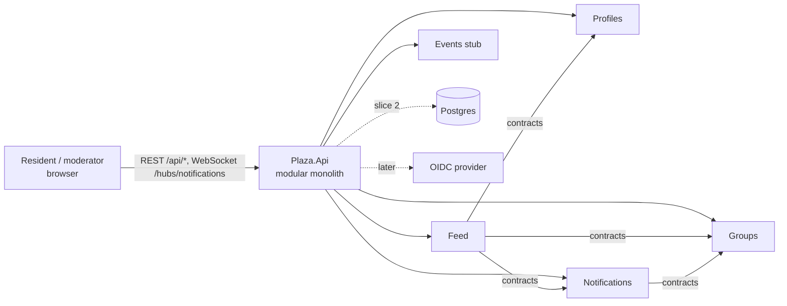

# Architecture

## Style and why
Advisor output (traits: ReadHeavy, PersonalData, SeveralBusinessAreas, LiveTracking, SmallTeam):

### Recommendation: ModularMonolith

Several business areas need clear boundaries, but one deployment and one database keep it cheap to run and easy to hand over.

#### Patterns
- **CachedReadModel**: Serve searches from a separate, cached read side so reads never slow down writes.
- **PersonalDataProtection**: Collect the minimum, encrypt it, log who read it, and be able to delete it (POPIA/GDPR).
- **ConnectionGateway**: Hold live connections in a dedicated gateway that scales separately from business logic.

#### Closest reference systems
- Community social network (profiles, groups, events) (similarity 0.67): At global scale: graph, groups, feed, events and notification services with an event stream between them; start as a modular monolith with the same module boundaries.
- Photo-sharing social feed (similarity 0.43): At global scale: media, graph, feed and notification services, a CDN for images, and feeds pre-built per follower (fan-out on write) with a pull fallback for very popular accounts.
- Software sold to many companies (CRM) (similarity 0.33): Modular monolith that keeps each company's data separate.

#### Risks to watch
- Modules decay into a big ball of mud unless boundaries are enforced by tests (no cross-module database access).

#### Evolve when
- One module needs to scale or deploy on a different schedule: extract only that module as a service.
- Separate teams own separate modules and block each other's releases.
- Search becomes the bottleneck: move it to a dedicated search service.

Record the final choice with write_adr, including what you rejected.

Judgement: Launch as a modular monolith (Profiles, Groups, Feed, Events, Notifications) with SignalR for live notifications. Module boundaries match the services the advisor proposes at global scale.

At global scale the advisor's answer is **Microservices**. Evolution trigger: Extract Notifications first when live connections exceed what two app instances with a SignalR backplane hold (~50k), then Feed when group feeds dominate database load.
See `decisions/0001-architecture-style.md`.

## Context

Full C4, sequence, data-flow and ER diagrams: `docs/DESIGN.md`.

## Modules and boundaries
Layout: `src/Modules/<Module>/Plaza.<Module>` (internal, one public `*Module` registration class) + `Plaza.<Module>.Contracts` (public interfaces/records). A module may reference only `Plaza.SharedKernel` and other modules' `.Contracts`; `tests/Plaza.Tests/Architecture/ModuleBoundaryTests.cs` enforces it.

| Module | Owns | May call |
|---|---|---|
| Profiles | residents, verified flag (later address/phone: personal data stays here) | – |
| Groups | groups, memberships, roles (member/moderator) | – |
| Feed | posts, idempotency keys, append-only moderation log | Groups, Profiles, Notifications contracts |
| Events | event calendar (stub: membership check, no events) | Groups contract |
| Notifications | `NotificationsHub` at `/hubs/notifications`, one SignalR group per neighbourhood group (`group:{groupId}`) | Groups contract |

## Cross-cutting
- **Auth:** dev-only `X-Demo-User` header / `demoUser` query (`DemoUserAuthenticationHandler`), allowed only when `Auth:Mode=Demo` **and** environment is Development. Endpoints use `ICallerIdentity`; OIDC replaces the scheme in `AuthSetup` only.
- **Errors:** RFC 9457 ProblemDetails with a stable `code` extension (`not_a_member`, `not_verified`, `not_a_moderator`, `body_too_short`, ...).
- **Time:** `TimeProvider` everywhere (tests use a manual clock).
- **Idempotency:** `Idempotency-Key` header on `POST /posts`, scoped per author.
- **Health:** `/health/live` (process), `/health/ready` (module stores; DB ping in slice 2).
- **Persistence:** thread-safe in-memory stores behind interfaces; Postgres in slice 2.
- **Logging:** source-generated `LoggerMessage`, no personal data. OpenTelemetry pending package restore.
