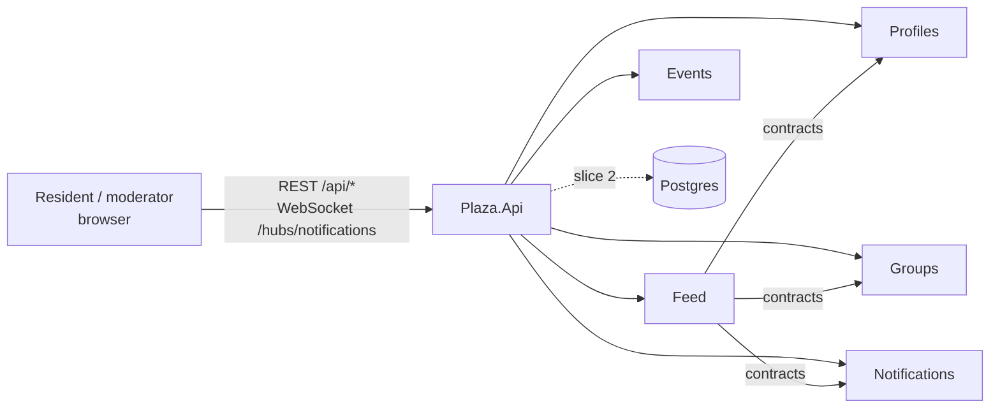

# Plaza

An original community social network for neighbourhood associations: verified residents post notices and safety alerts in their neighbourhood group, members read them newest-first, online members get a live notification, and moderators remove posts with an audit trail. Showcase project: the client (Buurt Forum) and every person, street and number are invented.

## Design at a glance
**Brief:** 120 fictional neighbourhood associations run on scattered chat groups and email lists, so notices get lost and nobody knows who lives in the area. Plaza gives each neighbourhood one group with verified members, so a safety alert reaches every member within 10 seconds.

**Architecture:** a **modular monolith** (Profiles, Groups, Feed, Events, Notifications) in one ASP.NET Core process with SignalR for live notifications. Five business areas need clear boundaries, but four engineers need one thing to deploy. The architecture advisor rates this "Recommended" for the launch traits and microservices "Poor fit" for a small team. The modules match the services it proposes at global scale, and architecture tests enforce the boundaries, so Notifications can be extracted first when live connections pass ~50k (ADR-0001). Full reasoning, capacity sums, sequence diagrams and failure modes: [`docs/DESIGN.md`](docs/DESIGN.md).



## What it does (slice 1)
- `GET /api/groups/{groupId}/posts`: the group feed, newest first (members only, otherwise 403).
- `POST /api/groups/{groupId}/posts`: verified members post a `notice` or `safetyAlert` (`Idempotency-Key` header supported).
- `/hubs/notifications`: SignalR hub; online members of the group get `notification` events.
- `POST /api/groups/{groupId}/posts/{postId}/removal`: moderators remove a post with a reason, written to the append-only `GET /api/groups/{groupId}/moderation-log`.
- Web app (`web/`): the neighbourhood group page with composer, feed, live toasts and a demo user switcher.

Sign-in is a **development-only** `X-Demo-User` header standing in for OIDC (planned slice).

## Run locally
```bash
ASPNETCORE_URLS=http://localhost:5102 ASPNETCORE_ENVIRONMENT=Development dotnet run --project src/Plaza.Api
cd web && npm ci && npm run dev
```
Tests and details: `.agentic/runbook.md`.

## How this project is organised
Project knowledge lives in the hidden `.agentic/` folder (start with `.agentic/README.md`). AI agents read `AGENTS.md` first.

Built with the Baton model from the Agentic Engineering Kit: frame → map → decide → sketch → slice loop → pass the baton.
