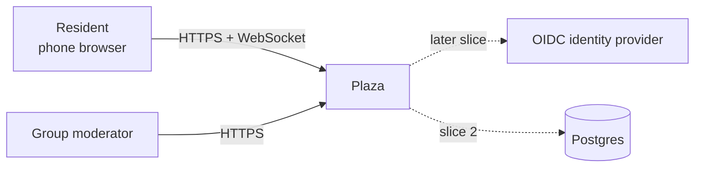
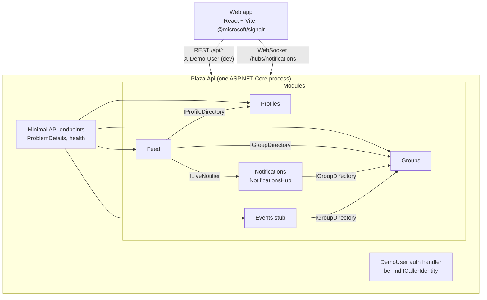
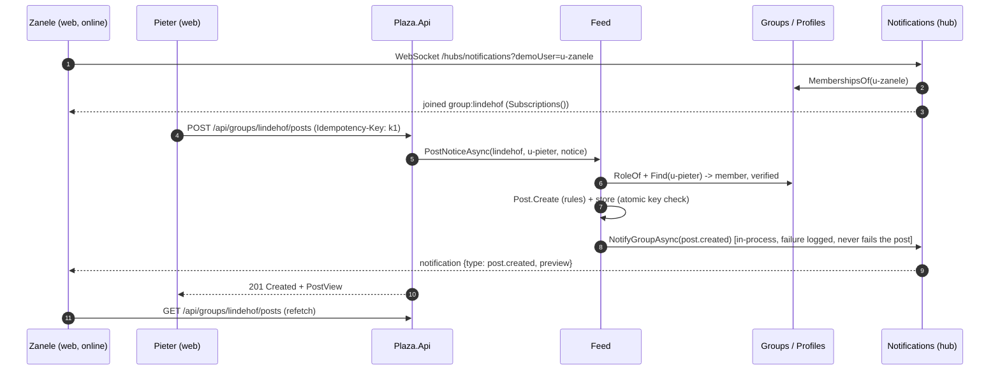
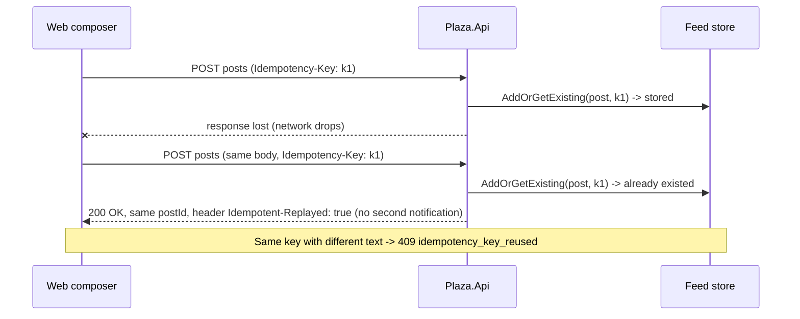
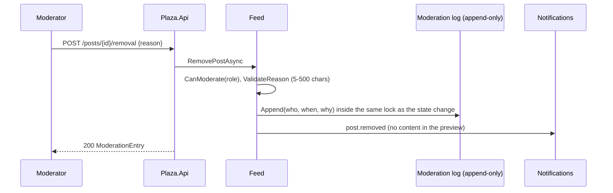
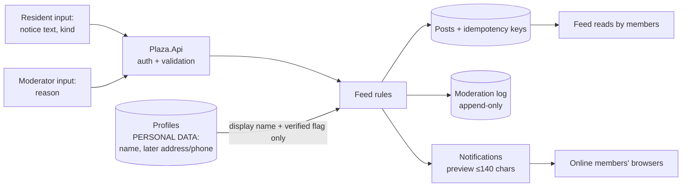
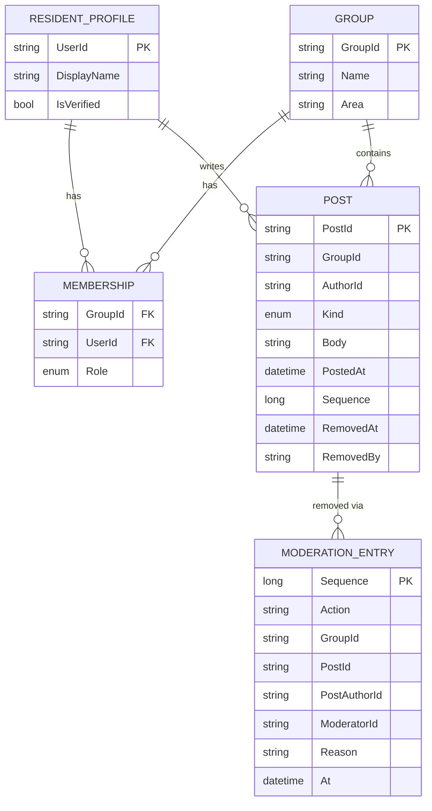

# Plaza: design dossier

Plaza is an original community social network for neighbourhood associations. Showcase project: the client, every person, street and number is invented.

## 1. Brief
- **Client:** Buurt Forum (fictional), a federation of 120 neighbourhood associations.
- **Problem:** associations run on scattered chat groups and email lists, so notices get lost, events are missed and nobody knows who actually lives in the area.
- **Users:** residents (daily, mobile), group moderators (weekly), association admins (monthly).
- **Outcomes:** safety alerts reach every member of a group within 10 seconds; 80% of an association's households verified in 3 months.
- **Constraints:** addresses visible only to verified neighbours in the same group; moderators can remove posts with an audit trail.

## 2. Requirements
**Functional (slice 1, done):**
- A verified resident posts a notice or safety alert in their group (`POST /api/groups/{groupId}/posts`, `Idempotency-Key` header).
- Members read the group feed newest-first (`GET /api/groups/{groupId}/posts?limit=`); non-members get 403 `not_a_member`.
- Online members get a live notification over SignalR (`/hubs/notifications`, one SignalR group per neighbourhood group).
- Moderators remove a post with a reason (`POST /api/groups/{groupId}/posts/{postId}/removal`); the removal goes to an append-only moderation log (`GET /api/groups/{groupId}/moderation-log`).

**Next:** slice 2 persistence (Postgres, EF Core) behind the same interfaces; then OIDC sign-in, address verification, events.

**Non-functional:**
| Concern | Target | Source |
|---|---|---|
| Alert delivery to online members | p95 < 10 s end to end (goal: < 2 s) | product outcome |
| API latency | p95 < 300 ms | `quality.md` |
| Availability | 99.9% / 30 days | `quality.md` |
| Feed freshness | a new post is visible on the next read (strong consistency inside Feed) | design choice |
| Retention | posts kept while the group exists; moderation log kept 3 years (assumption, to confirm with the client) | assumption |
| Privacy | no address or phone outside the Profiles module; POPIA/GDPR delete on request | product constraint |

## 3. Capacity estimate (assumptions, rounded up)
- 120 associations × ~800 households × ~1.5 adults ≈ **150k residents**; 30% daily active ≈ **45k DAU**.
- Reads: 20 feed loads per DAU per day ≈ 900k/day ≈ **10 req/s average, ~100 req/s peak** (10× evening peak).
- Writes: 0.3 posts per DAU per day ≈ 14k posts/day ≈ **0.2 posts/s average, ~5/s peak** (an incident sets off a burst).
- Storage: 14k posts × ~1 KB ≈ 14 MB/day ≈ **5 GB/year** with indexes. The moderation log is tiny (<1% of posts).
- Live connections: 15% of residents online at peak ≈ **22k concurrent WebSockets**. One safety alert fans out to ~1,200 members (one association), so ~200 online connections per alert.
- Bandwidth: a notification is ~400 bytes, so even 100 alerts/min reach far under 1 MB/s.

Read:write is ~60:1, so the read side matters most. That is why the advisor's ReadHeavy trait points to cached read models.

## 4. Options considered
Output of `arch-advisor compare` with the launch traits (ReadHeavy, PersonalData, SeveralBusinessAreas, LiveTracking, SmallTeam):

| Option | Fit | Complexity (1-5) | Main reason |
|---|---|---|---|
| Modular monolith + CQRS read models | Recommended | 3 | Matches the advisor's recommended style (ModularMonolith). |
| Modular monolith | Good alternative | 3 | Same family as the recommendation (ModularMonolith); a valid variant if its trade-offs suit the team. |
| Serverless functions + queues | Possible | 3 | Small team: low enough operational load to run comfortably. |
| Static site + serverless function | Poor fit | 1 | The product has real server-side behaviour and data; a static site can't hold it. |
| Layered monolith | Poor fit | 1 | Several business areas would tangle without module boundaries. |
| Vertical slice monolith | Poor fit | 2 | Several business areas would tangle without module boundaries. |
| Clean Architecture monolith | Poor fit | 2 | Several business areas would tangle without module boundaries. |
| Event-sourced core with CQRS | Poor fit | 4 | Event sourcing's cost isn't repaid without audit, money or replay needs. |
| Microservices (request/response) | Poor fit | 5 | A small team can't run a distributed system well (deployments, tracing, on-call). |
| Event-driven microservices | Poor fit | 5 | A small team can't run a distributed system well (deployments, tracing, on-call). |

With the global-scale traits (ReadHeavy, PersonalData, SeveralBusinessAreas, LiveTracking, GlobalScale):

| Option | Fit | Complexity (1-5) | Main reason |
|---|---|---|---|
| Event-driven microservices | Recommended | 5 | Matches the advisor's recommended style (Microservices). |
| Serverless functions + queues | Good alternative | 3 | Same family as the recommendation (Microservices). |
| Microservices (request/response) | Good alternative | 5 | Same family as the recommendation (Microservices). |
| Modular monolith | Possible | 3 | Live updates: push over WebSockets/SignalR from the module that owns the state. |
| Modular monolith + CQRS read models | Possible | 3 | Read-heavy: separate read models keep queries fast. |
| Static site + serverless function, Layered, Vertical slice, Clean Architecture, Event-sourced | Poor fit | 1–4 | As above. |

**Why the choice:**
- **Modular monolith (chosen, ADR-0001):** five business areas need boundaries; four engineers need one deployable. Modules match the future services, so extraction later is a deployment change. Boundaries are enforced by `ModuleBoundaryTests`.
- **+ CQRS read models (adopted gradually):** the 60:1 read ratio makes this right. Slice 1 reads straight from the in-memory store (fast enough at 100 req/s). A denormalised, cached feed read model is the first scaling step (section 9). We did not add it now because it would add eventual consistency before any load needs it.
- **Serverless + queues (rejected):** 22k long-lived WebSockets fit poorly with short-lived functions, and cold starts work against the 10-second alert target.
- **Microservices (rejected now, planned at scale):** five deployables, tracing and on-call for four engineers. **Evolution trigger (ADR-0001):** extract Notifications first when live connections exceed what two app instances with a SignalR backplane hold (~50k), then Feed when group feeds dominate database load.
- **Event sourcing (rejected):** only moderation needs history, and an append-only log table gives that for far less cost.
- **Layered / vertical slice / Clean monolith (rejected):** none separates five business areas on its own.

## 5. Architecture
### C4 context

### C4 containers

### Modules and contracts
Each module is `src/Modules/<Module>/Plaza.<Module>` (internal implementation, one public `*Module` registration class) plus `Plaza.<Module>.Contracts` (public interfaces and records). A module may reference only other modules' `.Contracts`.

| Module | Owns | Public contract | Uses |
|---|---|---|---|
| Profiles | residents, verification flag (later: address, phone) | `IProfileDirectory`, `IProfileRegistration`, `ResidentProfile` | – |
| Groups | neighbourhood groups, memberships, roles | `IGroupDirectory`, `IGroupAdministration`, `GroupRole` | – |
| Feed | posts, idempotency keys, moderation log | `IFeedService`, `IFeedImport`, `PostView`, `ModerationEntry` | Groups, Profiles, Notifications contracts |
| Events | neighbourhood events (stub in slice 1) | `IEventCalendar` | Groups contract |
| Notifications | live connections, SignalR groups | `ILiveNotifier`, `LiveNotification`, `NotificationChannels` | Groups contract |

## 6. Communication flows
### Slice 1: post a notice and notify online members

Sync: everything up to the 201. Async in effect: the SignalR push (fire and forget per connection). Slice 2 puts the push behind a **transactional outbox** row written with the post, so a crash between store and push can't lose the alert.

### Riskiest flow: retry after a timeout (duplicate request)

The composer keeps one key per draft and only makes a new one after a success, so a retry can never double-post.

### Moderation

## 7. Data flow

Personal data stays in Profiles; other modules receive only display name and verified flag. No money in this product.

## 8. Data model

| Entity | Owner module | Consistency |
|---|---|---|
| ResidentProfile | Profiles | strong inside Profiles |
| Group, Membership | Groups | strong; other modules read through `IGroupDirectory` |
| Post, idempotency key | Feed | strong (one lock now, one transaction in slice 2) |
| ModerationEntry | Feed | strong with the post's removed state; insert-only |
| Author name on a post | Feed reads Profiles at query time | eventual once a cached read model exists |
| Live notification | Notifications | best effort now; at-least-once with the outbox (slice 2) |

## 9. Scaling path (what breaks first, in order)
1. **Feed reads** (~100 req/s now, 10× with growth): add a cached, denormalised feed read model per group (CQRS read side), invalidated by `post.created`/`post.removed`. Keyset paging (`before=` cursor).
2. **One instance** (deploy safety): run two instances behind a load balancer with a SignalR backplane (Redis or a managed SignalR service). Sticky sessions or WebSockets-only transport.
3. **Live connections > ~50k**: extract Notifications as its own service fed by an event stream (ADR-0001 trigger). It already only depends on `IGroupDirectory`.
4. **Feed write/read load dominates the database**: extract Feed; partition posts by `GroupId` (all reads are per group, so there is no cross-partition query).
5. **Hot groups** (a city-wide alert): fan-out on write to per-member inboxes for normal groups, pull for very large groups (the photo-feed reference pattern).
6. **Images** (later slice): object storage + CDN, never through the API.

## 10. Failure modes
| Failure | Effect | Mitigation |
|---|---|---|
| SignalR push throws | Post is stored; online members miss the toast | Caught and logged (`A_failing_push_does_not_fail_the_post`); feed shows it on next read; outbox + retry in slice 2 |
| Duplicate POST (retry, double tap) | Could double-post and double-alert | `Idempotency-Key` per author; replay returns 200 with the same post and no second push |
| Same key, different text | Ambiguous intent | 409 `idempotency_key_reused` |
| Two moderators remove at once | Double log entries | State change and log append in one lock; second gets 409 `already_removed` |
| WebSocket drops (mobile) | Missed toasts | Client auto-reconnect, rejoins groups on connect; feed refetch on reconnect is a follow-up |
| App restart | In-memory data lost (slice 1) | Known: slice 2 Postgres. Demo data reseeded in Development |
| Region outage | Plaza down | Single region at launch (99.9% target); restore from backups in a paired region (runbook, slice 2+) |
| Hot key (city-wide alert group) | One SignalR group with many connections | Backplane fan-out; at scale Notifications extracted and scaled out |
| Poison message | n/a in slice 1 (no queue) | With the outbox: retry with backoff, dead-letter after 5 attempts, alert |

## 11. Security and privacy
- **AuthN:** slice 1 uses a **development-only** `X-Demo-User` header (or `demoUser` query for WebSockets). `AuthSetup` refuses to start it outside Development and refuses to start at all without `Auth:Mode=Demo`, so it can't ship by accident. Endpoints depend on `ICallerIdentity`, so OIDC replaces one registration.
- **AuthZ:** every group endpoint checks membership through `IGroupDirectory` (403 `not_a_member`); posting needs verification (403 `not_verified`); moderation needs the moderator role (403 `not_a_moderator`). The hub requires an authenticated user and only joins that user's groups.
- **Privacy (POPIA/GDPR):** minimum data on the wire (name + verified flag, never address or phone); personal data owned by one module so deletion is local; notification previews omit removed content.
- **Secrets:** none in slice 1; later from a vault, never appsettings.
- **Threats per flow:** posting: spam and abuse, handled by verification and moderation (rate limits are next); live: a forged identity is possible with the demo header, which is why it's Development-only; moderation: repudiation, handled by the append-only log with who/when/why.

## 12. Observability
- **SLIs/SLOs:** see `.agentic/quality.md` (API success 99.9%, p95 < 300 ms, alert delivery p95 < 10 s, live connection success 99%).
- **Metrics:** posts/min by kind, notifications sent and failed, live connections, feed read latency, 403 rate (abuse or bad links).
- **Traces:** OpenTelemetry exporter (NuGet, added once package restore is available): POST → Feed → notify span, with `traceparent` propagated.
- **Logs:** structured, no personal data; `LogNotifyFailed` warns on push failures.
- **The alert that wakes someone:** safety-alert delivery failures > 1% over 5 minutes, or `/health/ready` failing on all instances.

## 13. Testing strategy
| Layer | Here | Where |
|---|---|---|
| Rules | `Post` (body length, kind, removal, preview), `FeedPolicy` (read, post, moderate, reason) | `tests/Plaza.Tests/Domain` |
| Use cases | `FeedService` with in-memory stores and fakes: ordering, idempotency, notify, push failure, moderation log append-only | `tests/Plaza.Tests/Application` |
| End to end (API) | Real Kestrel on a random port, real HTTP, a raw SignalR JSON-protocol WebSocket client | `tests/Plaza.Tests/Acceptance` |
| Boundaries | Assembly references, exported types, InternalsVisibleTo, csproj references | `tests/Plaza.Tests/Architecture` |
| Web | Vitest: feed ordering and notifications, API client headers and problems, Composer (validation, idempotent retry), token drift | `web/src/**/*.test.ts(x)` |

Acceptance criteria → tests:
| Criterion | Tests |
|---|---|
| Member posts → newest-first feed | `Ac1_member_post_appears_at_the_top_of_the_feed`, `Ac1_retry_with_the_same_idempotency_key_does_not_duplicate`, `Posts_come_back_newest_first_even_with_equal_timestamps` |
| Non-member → 403 | `Ac2_non_member_gets_403_on_the_feed`, `Ac2_anonymous_and_unknown_callers_get_401`, `Non_members_cannot_read` |
| Online members get a live notification | `Ac3_online_members_receive_a_live_notification_and_outsiders_do_not`, `Ac3_hub_rejects_anonymous_connections`, `A_new_post_sends_a_live_notification_to_the_group` |
| Moderator removal hidden + logged who/why | `Ac4_moderator_removal_hides_the_post_and_is_logged_with_who_when_and_why`, `Ac4_members_cannot_remove_posts_or_read_the_moderation_log`, `Moderation_log_is_append_only` |

## 14. Interview questions
1. **How would you scale the feed to 10M users?** Partition by group (every read is per group), serve reads from a cached per-group read model, fan out on write to inboxes for normal groups and pull for huge ones, and extract Feed as a service when it dominates database load.
2. **How do you guarantee a safety alert arrives within 10 seconds?** In-process push right after the write (milliseconds today). At scale: outbox → stream → Notifications service with a backplane; measure end-to-end delivery as an SLI and alert on it. Offline members need web push/SMS, which is a later slice.
3. **What if the same post request arrives twice?** The `Idempotency-Key` (per author) makes the second one return the original post with 200 and no second notification; different text with the same key is a 409.
4. **Why not microservices from day one?** Four engineers, ~100 req/s. The advisor scores microservices "poor fit" for a small team. Module boundaries match the future services, and tests enforce them, so extraction is cheap when the ADR trigger fires.
5. **How do you stop modules turning into a big ball of mud?** Contracts projects, internal implementations, and `ModuleBoundaryTests` that fail on any reference to another module's implementation project or internals.
6. **How is the moderation log tamper-resistant?** The interface has only `Append` and `ForGroup` (a test checks this); entries are immutable records; slice 2 uses an insert-only table with no UPDATE/DELETE grant for the app user.
7. **How do you keep addresses private?** Only Profiles holds them; contracts expose name and verified flag; notifications carry a ≤140-character preview and no author details beyond the name.
8. **Why SignalR groups per neighbourhood instead of per user?** One send reaches every online member of a group; membership is resolved once at connect. Per-user sends would need N lookups per post.
9. **What happens when a member joins a group while connected?** Today they get its notifications after reconnecting. Fix: Groups publishes `member.joined` and Notifications adds the live connection to the SignalR group.
10. **How would you replace the demo header with real sign-in?** Add the OIDC/JWT scheme in `AuthSetup`, map the subject claim to `ClaimTypes.NameIdentifier`, pass the access token as `access_token` for WebSockets; endpoints and modules don't change because they use `ICallerIdentity`.
